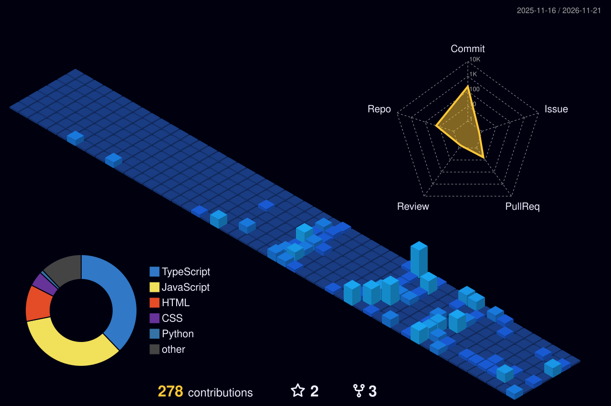

<!-- GitHub profile README: github.com/ChiragVasava/ChiragVasava -->

<strong>Computer Science &amp; Engineering student · Building full-stack applications and AI-assisted developer tools</strong>

  
  
  
  

## 👋 About me

I'm **Chirag Vasava**, a Computer Science and Engineering student at **The Maharaja Sayajirao University of Baroda**, based in **Vadodara, India**.

I develop web applications that bring together thoughtful user interfaces, backend services, databases, and practical AI integrations. I enjoy solving real workflow problems—whether that means helping developers generate tests, making campus recruitment easier to manage, or building tools to inspect and modify web interfaces.

- **Engineering interests:** Full-stack and backend development, developer tooling, software testing, and LLM-powered features.
- **My approach:** Build useful features, understand the underlying architecture, write maintainable code, and improve through testing and feedback.
- **Currently strengthening:** Data structures and algorithms, system design fundamentals, and deployment workflows.
- **Open to:** Software engineering internships, full-stack/backend opportunities, and technical collaborations.

## 🚀 Selected projects

### 🧪 [TestForge AI](https://github.com/ChiragVasava/TestForge-AI) — AI-assisted testing platform

**Python · FastAPI · Next.js · TypeScript · PyTest · Playwright · Gemini API**

A developer-focused testing platform that combines source-code analysis with AI-assisted test preparation.

- Inspects Python source code with **Abstract Syntax Trees (AST)** and prepares PyTest test scaffolds.
- Integrates **Gemini** to propose edge cases and assertions; supports generating **Playwright** browser-test scripts from test descriptions.
- Brings testing workflows together through an application interface and **GitHub Actions** integration.

**[Explore the code and documentation](https://github.com/ChiragVasava/TestForge-AI)**

### 🎓 [UniNest AI](https://github.com/ChiragVasava/UniNest-AI) — Campus recruitment platform

**Next.js · TypeScript · Express.js · PostgreSQL · Prisma · Gemini API**

A full-stack platform for managing student recruitment, from discovering placement drives to tracking applications and offers.

- Built **student and company workflows** for placement drives, applications, resumes, interviews, and offers.
- Integrated **Gemini-powered resume–job description analysis** with structured ATS-style feedback and a heuristic fallback.
- Connected the web interface to a **versioned REST API**, using **Prisma/PostgreSQL** and authentication/role-based access controls.

**[Explore the code and documentation](https://github.com/ChiragVasava/UniNest-AI)**

### 🔎 [DOMLens](https://github.com/ChiragVasava/DOMLens) — AI-assisted Chrome extension

**JavaScript · HTML · CSS · Chrome Extension APIs · Shadow DOM · Gemini API**

A browser tool for inspecting webpage components and working with interface changes through natural-language instructions.

- Inspects **DOM elements and styles** to understand a selected component's structure and appearance.
- Uses **AI-assisted HTML/CSS editing** to help explore interface modifications and previews.
- Uses **Shadow DOM** to isolate the extension's UI from the styles of the inspected website.

**[Explore the extension and documentation](https://github.com/ChiragVasava/DOMLens)**

## 🛠️ Technical toolkit

**Languages**

**Frontend**

**Backend, data & AI**

**Testing & developer tools**

## 🏆 Hackathons & learning

- **Hack-A-Throne 2025 — Team Leader:** Led a team during a **32-hour hackathon** at MSU Baroda, working on an AI-powered event management portal with vendor recommendations and multi-role dashboards. [View certificate](https://drive.google.com/file/d/1DPMBYSVvUNs7xF1q-Y2qZnjy-8wpOt5G/view?usp=sharing).
- **Odoo × GCET Hackathon 2026 — Offline Final Round:** Advanced through virtual screening with **RentFlow**, an ERP-style rental management solution for quotations, orders, payments, and invoices. [View certificate](https://drive.google.com/file/d/19Ra3fa93NudPUaLhAkiNNp80zwzLdcey/view?usp=sharing).

**Education**

- **B.E., Computer Science and Engineering** — The Maharaja Sayajirao University of Baroda *(2024–2027, pursuing)*
- **Diploma, Information Technology** — Parul University *(2021–2024)*

**Certifications:** [UI/UX Design with AI](https://drive.google.com/file/d/1lpESOSXQ30ePfjXJI2Uv4l50OiRhTO7w/view?usp=sharing) · [Machine Learning with Python](https://drive.google.com/file/d/1BOL2_XZB7TD59nrVgORgMsemUXqUfwZl/view?usp=sharing) · [Git Foundation](https://drive.google.com/file/d/1VYZ0f6Im-39QmGVpcPAtRBlM4SLow_0y/view?usp=sharing)

## 📊 GitHub activity

<picture>
  <source media="(prefers-color-scheme: dark)" srcset="https://raw.githubusercontent.com/ChiragVasava/ChiragVasava/output/github-contribution-grid-snake-dark.svg" />
  <source media="(prefers-color-scheme: light)" srcset="https://raw.githubusercontent.com/ChiragVasava/ChiragVasava/output/github-contribution-grid-snake.svg" />
  
</picture>

  
<strong>View my 3D contribution graph</strong>

   
  

    
  

## 🤝 Let's connect

I enjoy discussing practical software engineering problems and collaborating on meaningful projects. If you're reviewing my work for a **software engineering internship** or would like to build something together, feel free to reach out.

**[Portfolio](https://portfolio.chiragvasava.me/)** · **[LinkedIn](https://www.linkedin.com/in/chirag-vasava-050784273/)** · **[Email](mailto:v.chira.007@gmail.com)** · **[GitHub repositories](https://github.com/ChiragVasava?tab=repositories)**

---

Build thoughtfully. Test carefully. Keep learning.

